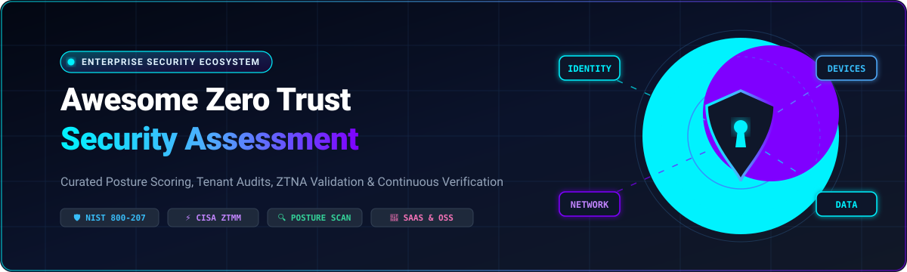

    

  

  

# 🛡️ Awesome Zero Trust Security Assessment

### Curated Posture Scoring, Tenant Configuration Audits, ZTNA Validation & Continuous Identity Auditing

---

## 📌 Table of Contents

- [🌐 Overview & Executive Summary](#-overview--executive-summary)
- [📊 Sector Overview & Market Dynamics](#-sector-overview--market-dynamics)
- [☁️ SaaS & Commercial Hosted Platforms](#️-saas--commercial-hosted-platforms)
- [🔓 Open-Source GitHub Projects](#-open-source-github-projects)
  - [Zero Trust Assessment & Posture Auditing](#1-zero-trust-posture-assessment--tenant-auditing)
  - [Zero Trust Policy & Microsegmentation Enforcement](#2-zero-trust-policy-access-proxy--microsegmentation-enforcement)
- [🤝 How to Contribute](#-how-to-contribute)
- [💖 Support & Community](#-support--community)
- [📈 Star History](#-star-history)
- [⚠️ Disclaimer](#️-disclaimer)

---

## 🌐 Overview & Executive Summary

This curated repository tracks the premier **SaaS platforms** and **open-source security tooling** designed for **Zero Trust Security Assessment** and **Continuous Posture Auditing**. Rooted in foundational zero-trust mandates (such as **NIST SP 800-207**, the **CISA Zero Trust Maturity Model (ZTMM)**, and **US Executive Order 14028**), these solutions enable enterprise security teams, cloud architects, and compliance auditors to rigorously validate controls across five core pillars:

1. **Identity & Credentials**: Enforcing continuous adaptive authentication, phishing-resistant MFA (FIDO2), and eliminating over-privileged service accounts.
2. **Devices & Endpoints**: Continuous telemetry verification, dynamic posture scoring, EDR integration, and device hygiene compliance.
3. **Networks & Microsegmentation**: Least-privilege lateral movement prevention, software-defined perimeters (SDP), and dynamic ZTNA proxies.
4. **Workloads & Applications**: Policy-as-code admission control, container isolation, secretless API connectivity, and runtime integrity checks.
5. **Data & Tenant Governance**: Sensitive data classification, cross-tenant misconfiguration detection, and encrypted data-in-transit validation.

---

## 📊 Sector Overview & Market Dynamics

The global **Zero Trust Security and Architecture market** is valued at approximately **$44.8B to $49.4B in 2026** and is projected to surge past **$140B by the mid-2030s**, compounding at an aggressive **CAGR of 15% to 17%**. 

**Market Structure & Concentration Dynamics**:
The sector exhibits a **moderately fragmented yet rapidly consolidating "platformized" market structure**. While traditional enterprise networking and identity have seen dominant multi-billion-dollar incumbents (Microsoft in enterprise identity/tenant auditing, Palo Alto Networks and Cisco in network firewalls/SASE, CrowdStrike in endpoint posture, and Zscaler in cloud security service edges), no single vendor possesses a monopoly across all five NIST zero trust pillars. Instead, the landscape features intense platformization where leading vendors integrate posture assessment APIs, co-existing with vibrant modular best-of-breed open-source policy engines (like Open Policy Agent and Cilium) that organizations stitch together to avoid vendor lock-in.

---

## ☁️ SaaS & Commercial Hosted Platforms

The table below catalogs leading commercial Zero Trust Assessment and enforcement SaaS platforms, **sorted in descending order by company valuation / market capitalization** to provide clarity on enterprise scale, vendor stability, and market footprint.

| Company & Product | Description | Starting Pricing | Free Tier / Free Trial Limits | Valuation / Market Size |
| :--- | :--- | :--- | :--- | :--- |
| **[Microsoft Zero Trust Assessment](https://learn.microsoft.com/en-us/security/zero-trust/assessment/overview)** | Automated tenant posture tool testing hundreds of configuration items across Microsoft 365 and Azure against Zero Trust pillars, with remediation guidance in an interactive HTML dashboard. | **Free / $0** (Open-source assessment engine requiring only existing M365/Azure tenant credentials; Entra ID P1/P2 remediation licenses start at $6/user/month) | **Free forever**; unlimited tenant evaluation runs and configuration checks (no user limits on the assessment tool itself). | **~$3.94 Trillion** *(Market Cap)* |
| **[Cisco Zero Trust Assessment](https://duo.com/solutions/zero-trust-security)** | Identity-driven assessment and enforcement suite covering phishing-resistant MFA, posture checks, continuous verification, and SASE readiness; validated detection of 30 identity-based attacks in independent SE Labs testing. | **$3/user/month** (Duo Essentials, billed annually; Cisco Secure Access enterprise SSE packages start at ~$15–$25/user/month) | **30-day free trial** (Duo paid plans) or **Duo Free plan** (permanently free up to **10 users** with unlimited app integrations). | **~$435 Billion** *(Market Cap)* |
| **[CrowdStrike Falcon Zero Trust Assessment](https://www.crowdstrike.com/)** | Real-time endpoint security and compliance scoring within Falcon Insight; evaluates over 120 endpoint settings (sensor health, applied policies, OS security) and produces an overall score shareable with Zero Trust ecosystem partners for conditional access enforcement. Supports Windows, macOS, and Linux with API access. | **$59.99/device/year** (Falcon Go tier; enterprise packages typically ~$90–$180/device/year) | **15-day free trial**; covers up to 100 devices (includes Falcon Prevent NGAV and USB Device Control). | **~$265 Billion** *(Market Cap)* |
| **[Palo Alto Networks Zero Trust Posture Center](https://www.paloaltonetworks.com/)** | Unified workspace within Strata Cloud Manager mapping NGFW and Prisma Access deployments across five dimensions (network configuration, identity, least privilege, inspection, data control); delivers prioritized recommendations and real-time impact analysis. | **$110/user/year** (Prisma Access Mobile User Business tier; Strata Cloud Manager Pro add-on priced at ~30% of NGFW estate value) | **30-day guided evaluation / PoC**; evaluation licenses coordinated via sales/reseller console (Prisma Cloud offers instant 30-day self-service trial). | **~$250 Billion** *(Market Cap)* |
| **[Zscaler Zero Trust Exchange](https://www.zscaler.com/)** | Cloud-native Zero Trust platform with inline inspection (ZIA), private application access (ZPA), and continuous posture validation; provides Risk360 telemetry to identify control gaps across cloud and SaaS environments. FedRAMP High and StateRAMP authorized. | **$72/user/year** (~$6/user/month for entry standalone ZIA/ZPA; combined bundles start at ~$250–$280/user/year) | **30-day proof of concept (PoC)**; evaluation access provisioned through sales engineering for scoped enterprise pilot environments. | **~$40 Billion** *(Market Cap)* |
| **[CyberArk Zero Trust](https://www.cyberark.com/)** | Identity security platform integrating with Palo Alto Networks and CrowdStrike to enforce identity-driven Zero Trust access; protects credentials, secrets, and privileged sessions, blocking out-of-compliance endpoints. | **$2/user/month** (CyberArk Identity Workforce SSO/MFA tier; CyberArk Privilege Cloud PAM starts at ~$2,400/privileged user/year) | **14-day free trial** (CyberArk Identity sandbox / virtual training tenant; enterprise PAM evaluated via structured vendor PoC). | **~$20.6 Billion** *(Market Cap)* |
| **[Akamai Zero Trust](https://www.akamai.com/)** | Microsegmentation (Guardicore), ZTNA (Enterprise Application Access), and FIDO2-compliant MFA; emphasizes agentless east-west traffic visibility and API security aligned with Executive Order 14028. FedRAMP authorized. | **$10/user/month** (~$120/user/year for Enterprise Application Access ZTNA; Guardicore priced per workload/server) | **60-day free trial** (Enterprise Application Access ZTNA trial provisioned via partner/sales onboarding request). | **~$14.2 Billion** *(Market Cap)* |
| **[BeyondTrust Zero Trust](https://www.beyondtrust.com/)** | Privileged Access Management (PAM) enforcing least privilege, removing local admin rights, isolating privileged sessions, and auditing activity against NIST/CISA Zero Trust tenets. FedRAMP authorized. | **$40/endpoint/year** (BeyondTrust Endpoint Privilege Management entry tier, typically under 1,000–asset contracts) | **14-day free trial** (Privileged Remote Access / Remote Support); Endpoint Privilege Management provided via guided enterprise PoC. | **~$3B – $5B** *(Clearlake Capital / ARR $500M+)* |
| **[Illumio Zero Trust](https://www.illumio.com/)** | Segmentation-first Zero Trust platform mapping workload connections in real time and auto-generating least-privilege policy across cloud, containers, endpoints, and data centers. | **$30/workload/year** (typical entry pricing for <1,000 workloads; enterprise minimum contracts typically start at $25,000/year) | **14-day free trial** (Illumio Insights); expires if no cloud flow logs are ingested within the first 7 days, with 30-day data retention. | **~$2.75 Billion** *(Series F Valuation)* |
| **[Duo Zero Trust](https://duo.com/)** | Cisco business unit providing identity-centric Zero Trust access control covering MFA, device trust telemetry, adaptive access policies, and continuous session verification across modern hybrid architectures. | **$3/user/month** (Duo Essentials tier; Duo Advantage is $6/user/month, Duo Premier is $9/user/month) | **Free forever for up to 10 users** (Duo Free plan: MFA, Duo Mobile push, unlimited application integrations; no device trust or SSO). | **Part of Cisco** *(Acquired for ~$2.35B)* |

---

## 🔓 Open-Source GitHub Projects

Open-source Zero Trust security projects span two critical domains: **posture assessment/tenant configuration auditing** (measuring adherence to zero-trust standards) and **enforcement platforms** (implementing the proxies, policy engines, and microsegmentation firewalls required to fulfill zero-trust requirements). 

All repositories below are **sorted in descending order by GitHub stargazer count**. Each badge is rendered in `style=social` with `color=white` and directly links to the respective repository's stargazers page.

### 1. Zero Trust Posture Assessment & Tenant Auditing

Tools that scan, audit, and benchmark your existing identity systems, cloud tenants, and multi-vendor configurations against NIST SP 800-207, CISA ZTMM, CIS benchmarks, and zero-trust guidelines.

| Project & GitHub_Stars | Focus & Pillar | Description |
| :--- | :--- | :--- |
| **[Prowler](https://github.com/prowler-cloud/prowler)**    | Multi-Cloud Tenant & Zero Trust Audit | Comprehensive open-source security tool for AWS, Azure, GCP, and Kubernetes. Includes hundreds of automated controls mapped directly to NIST SP 800-53, CIS Benchmarks, and CISA Zero Trust Maturity Model guidelines with HTML/JSON reporting. |
| **[ScoutSuite](https://github.com/nccgroup/ScoutSuite)**    | Multi-Cloud Posture Audit | Open-source multi-cloud security auditing tool by NCC Group. Gathers configuration data via cloud APIs to flag over-privileged IAM permissions, public storage access, and unsegmented network resources. |
| **[Cloud Custodian](https://github.com/cloud-custodian/cloud-custodian)**    | Policy-as-Code & Compliance Audit | CNCF rules engine for cloud security and governance. Allows organizations to define zero-trust guardrails as code (YAML) to validate compliance, auto-quarantine unapproved network exposure, and enforce least privilege. |
| **[Microsoft ZeroTrustAssessment](https://github.com/microsoft/zerotrustassessment)**    | M365 & Entra Tenant Posture | The premier open-source **Zero Trust tenant assessment** module (MIT, PowerShell 7). Connects read-only to Microsoft Graph, Entra ID, Intune, and Azure to audit hundreds of settings against NIST, CISA, and CIS standards with interactive HTML reports. |
| **[iam_audit](https://github.com/gerardokaztro/iam-audit)**    | AWS Identity & Access Audit | Specialized Python/Boto3 audit engine evaluating IAM users, role assumptions, access key rotation, and root MFA coverage across AWS Organizations to ensure adherence to least-privilege zero-trust tenets. |

---

### 2. Zero Trust Policy, Access Proxy & Microsegmentation Enforcement

Engines and proxies that implement zero-trust access control, kernel-level eBPF microsegmentation, and dynamic authorization. These projects provide the underlying enforcement plane measured during posture audits.

| Project & GitHub_Stars | Focus & Pillar | Description |
| :--- | :--- | :--- |
| **[Cilium](https://github.com/cilium/cilium)**    | eBPF Kernel Microsegmentation | High-performance open-source networking, observability, and security enforcement built on eBPF. Delivers transparent identity-aware Layer 3 to Layer 7 network security policies and dynamic microsegmentation across Kubernetes clusters. |
| **[Teleport](https://github.com/gravitational/teleport)**    | Identity-Based Infrastructure ZTNA | Open-source Zero Trust Access Plane for SSH, Kubernetes clusters, web applications, and relational databases. Enforces cryptographic identity-based access, automated certificate issuance, and comprehensive session recording. |
| **[Open Policy Agent (OPA)](https://github.com/open-policy-agent/opa)**    | Unified Policy-as-Code Engine | General-purpose policy engine that decouples policy decisions from service logic. Uses Rego to enforce fine-grained zero-trust authorization decisions across microservices, Kubernetes admission controllers, and API gateways. |
| **[Pomerium](https://github.com/pomerium/pomerium)**    | Identity-Aware Access Proxy | Cloud-native, identity-aware reverse proxy and Zero Trust Network Access (ZTNA) solution. Replaces legacy VPNs by validating identity, context, and device health dynamically on every single request. |
| **[Gatekeeper](https://github.com/open-policy-agent/gatekeeper)**    | Kubernetes Admission Governance | Open-source policy controller leveraging OPA to enforce declarative zero-trust guardrails, container runtime constraints, and resource posture verification within Kubernetes clusters. |
| **[Octelium](https://github.com/octelium/octelium)**    | Self-Hosted ZTNA Platform | Fully open-source Zero Trust access platform built on Kubernetes and identity-aware proxies. Features dynamic secretless access (HTTP, SSH, K8s, databases), ABAC policy-as-code, and continuous strong authentication (FIDO2/WebAuthn). |
| **[Aegis](https://github.com/pushkar-gr/Aegis)**    | Dynamic eBPF Microsegmentation | Open-source identity-based microsegmentation firewall powered by eBPF/XDP (Go control plane, Rust data plane). Employs a default-drop posture that dynamically opens network paths only following verified authentication. |

---

## 🤝 How to Contribute

We welcome contributions from cybersecurity practitioners, zero-trust architects, and open-source maintainers! 🌟

1. **Fork the repository** to your personal GitHub account.
2. **Create a descriptive feature branch**: `git checkout -b feature/add-new-zero-trust-tool`.
3. **Add or update entries** in `README.md`:
   - Follow the established markdown table schema.
   - For SaaS tools: ensure starting prices and free tier/trial limits are specific (no generic or placeholder values).
   - For open-source tools: include the social-styled white Stars_Badge linked directly to the stargazers URL.
4. **Test formatting and links**: Verify all markdown renders cleanly without broken anchors.
5. **Open a Pull Request**: Provide a brief summary of the added solution and its zero-trust relevance.

---

## 💖 Support & Community

Thank you for visiting and supporting the **Awesome Zero Trust Security Assessment** ecosystem! 🚀

Building and maintaining high-quality, research-backed cybersecurity resources requires continuous community collaboration. If you found this list valuable:
- ⭐ **Star this repository** to help other security practitioners discover it!
- 🍴 **Fork and share** with your teammates, security engineering groups, and SecOps channels.
- 💬 **Join our discussions** on [Discord](https://discord.gg/jc4xtF58Ve) to discuss zero-trust architectures and tooling.
- ☕ **Buy a coffee & sponsor the project**: Support ongoing research, open-source security tooling, and community initiatives via the [GitHub Sponsor Dashboard](https://github.com/sponsors/ishandutta2007).

---

## 📈 Star History

---

## ⚠️ Disclaimer

- This repository is a **community-curated research catalog** provided for informational and educational purposes. Inclusion does not imply official endorsement or certification.
- **Data Privacy & Sensitivity**: Zero-trust assessment tools interrogate core identity stores, firewall rules, and tenant configurations. Ensure that scans, telemetry ingestion, and output reports comply with internal data governance and authorization policies.
- **Licensing**: Always review individual vendor terms of service and open-source licenses before executing security assessment tooling in corporate production environments.
